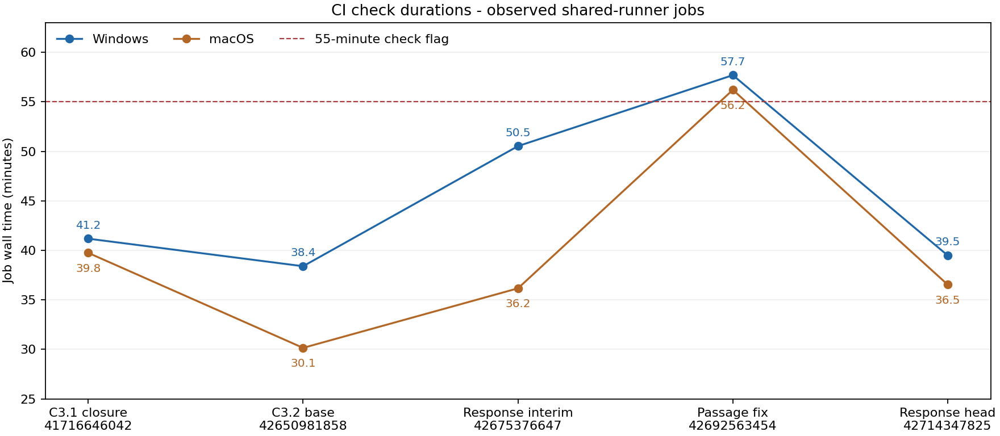

# M3 C3.2 independent review, round 2

**Verdict: block - SI-104 is not implemented, and undo/redo omit required animation invalidation events.** An explicit FOV of `41.1121` is reported unchanged but projected through the exact-default alias. Enabled reviewer regressions demonstrate both defects. Reviewed product head: `65cf4d88bdf530fe7970dfe37ac230198864c64c`. No product or specification file was edited. Findings: **0 P0 / 0 P1 / 2 P2**.

## Round-1 findings closure

| Finding | Disposition | Evidence and limits |
|---|---|---|
| C32-R1-01 | Closed | Node/extremum bracketing and 64-step full-resolution inversion inspected; inherited passage/corpus pass. New non-horizontal and preset boundary oracles are in `c32_r2_corpus` and `c32_r2_passage`. |
| C32-R1-02 | Withdrawn, unchanged ruling | Ownership glob was the review error; no renewed finding. |
| C32-R1-03 | Exact default closed; separate SI-104 finding below | Exact default constant, fixture/M1 default, schema/IPC description and tightened default assertions agree. The corrected inherited default oracle and command-boundary default oracle cover the ruled premise. |
| C32-R1-04 | Closed | `json_equal` recursively compares arrays/objects and exact integer/float values; only RFC `test` dispatch changed. `oldValue` checks are untouched. Inherited rollback tests and new boundary oracle cover signed zero, exponent spelling, large integers, unlike types and non-finite number representation refusals. |
| C32-R1-05 | Partially closed; C32-R2-02 | All-frame absence absorbs ranges in both orders; affected intervals use original and final neighbours. New event oracle passes direct scope/transaction checks but fails because undo/redo omit the event. |
| C32-R1-06 | Closed | Norm keeps the original expression for finite normal sums and scales otherwise. Registered results all pass the command-aware encoder; non-finite `anim.*` values become `anim.valueOutOfRange`. Inherited 26-peg and non-finite cases retained. E4 ordinary world/local/decomposition values are unchanged. |

## New finding C32-R2-01 - P2 - explicit FOV projection alias

**Clause/ruling:** SI-104, with SI-102; 05 camera/projection contract. `effectiveFov` and projection must use the same value.

**Reproduction:** `cargo test --locked -p tt-anim --test c32_r1_default_frame explicit_display_fov_is_not_aliased -- --exact`. The test stays enabled and failing. `camera::projection_fov` explicitly maps `DEFAULT_FOV_DISPLAY` to `DEFAULT_FOV`.

**Observed:** width `11.999999999999998` fields for explicit `41.1121`, while the stored/effective FOV remains `41.1121`. **Required:** approximately `12.00000306` fields; the exact default alone spans 12 fields. The oracle allows `1e-7` field around the explicit-width value, comfortably separating the two cases.

**Fix direction:** remove the alias and use the reported effective FOV directly in all projection paths. Update builder-owned alias assertions, ADR-0019 decision 11 and SI-104 text to the ruling; preserve exact-default assertions and explicit-value round trips. Do not change the reviewer regression to accept the alias.

## New finding C32-R2-02 - P2 - undo/redo omit animation invalidation

**Clause/charter:** 05 section 19.4, once-per-undo-step animation invalidation; charter A explicitly requires undo/redo events to carry the same scope.

**Reproduction:** `cargo test --locked -p tt-executor --test c32_r2_events -- --nocapture`. Both `interpolation_interval_survives_undo_redo` and `duplicated_function_key_reports_its_neighbour_interval` stay enabled and failing. `events-budget.txt` records `[0, 0]` for undo/redo event counts in both cases.

**Observed:** inserting a rotation key at frame 18 emits one `anim.changed` with frames 12-24; duplicating that function key to frame 19 emits one with frames 18-24. Each subsequent undo and redo succeeds but emits zero `anim.changed` events. **Required:** one event per replayed step with the same affected nodes/channels/frame scope. The direct move/remove/duplicate/segment intervals, both batch orders and separate-transaction checks pass.

**Fix direction:** preserve or reconstruct animation invalidation scope when committing history replay; emit the step union for undo and redo as well as direct edits, with current history/revision metadata. `run.rs::commit` currently reconstructs drawing events and emits `doc.changed`, but supplies no animation counterpart. Retain all-frame absence semantics and avoid duplicate direct-edit events.

## Register

[JSON](evidence/M3-C3.2-r2/register.json) and [readable register](evidence/M3-C3.2-r2/register.md) enumerate all 36 registry rows and all 383 source units, with no pending entry. Registry: **31 implemented / 5 divergent**. Source units: **291 implemented / 2 divergent / 90 deferred-with-owner**. The four camera/evaluation rows and projection-formula unit carry SI-104; the event row and section 19.4 event unit carry C32-R2-02. Every former divergent entry has a round-2 disposition. Implemented means the mapped surface has supporting finite evidence, not exhaustive proof over its input space. Deferred owners remain inherited; SI-089, SI-096, SI-097, SI-100, SI-101 and SI-103 are not reopened. No SI-105 is allocated.

## Declared edits adjudication

- The fixed-head ownership gate `git diff --stat 7458858..65cf4d8 -- 'crates/*/tests/c*_r[0-9]_*' tests/adversarial desktop/src/test reviews/evidence/M3-C3.2-r1` is empty. Merge `970d9e7` therefore preserves the reviewed files at the response head. C3.1 registers are also compared at fixed heads: 18/18 byte-identical (`c31-registers.json`).
- `change.rs`: numeric equality is restricted to RFC `test`; object member order is irrelevant and arrays remain ordered. Integers compare as i128; mixed float comparisons require an integral in-range value before conversion. No integer is rounded through f64 for equality. Failed-test rollback and exact `oldValue` semantics remain covered by inherited tests.
- Registry/macro result encoding: every registered handler now calls `encode_command_result(id, result)`; the typed refusal is restricted to `anim.*` and canonical invalid-number errors. Other encoding failures retain `internal`. No new product `unwrap`, `expect`, `panic`, `unsafe` or lint allowance appears in the response diff.
- CI: both E4 OS jobs run base and variant; cross-OS comparison includes variant bytes. `TT_C32_CASES=4096` reaches both maths and passage release properties. `c31_r3_sequences` body is byte-identical, skipped only in debug `check`, and actually runs/passes in the release review job on both OSes (Windows 259.40s; macOS 165.96s; raw timing receipts retain exact totals).
- CI rustfmt exclusion and `-A clippy::needless_range_loop` are declared temporary test/CI relaxations, not product allowances. The latter addresses the reviewer closed-form test. Both should be reverted in the builder response now that the ruling-authorized cleanup is supplied. The older `empty_line_after_doc_comments` exemption is outside this round's new allowance.
- `c32_semantics`: default constants replace rounded literals; camera tolerances tighten from `1e-5` to `1e-12`, and the projection oracle uses exact tangent 0.375. These do not weaken assertions. Builder-owned SI-104 alias assertions remain incompatible with the ruling and need correction with C32-R2-01.
- Plan section 5.3's ownership sentence follows the ruling. ADR-0019 decisions 2/5/7 are consistent with the inspected norm/finite-result and passage implementations; finite decomposition remains subject to representable f64 output range, with typed refusal otherwise. Decision 11's exact-default portion is accepted, but its explicit-value alias is rejected under C32-R2-01, just like the SI-104 text. Decision 12 describes the accepted direct-edit interval/all-frame union; history delivery remains incomplete under C32-R2-02. SI-102 exact default is accepted.

### Reviewer-owned edits and assertion comparison

1. `c32_r1_default_frame.rs`: before, the 12-field assertion constructed an explicit `41.1121`; after, the same `1e-6` assertion constructs `tt_model::defaults::DEFAULT_FOV`. This is the precise ruling-authorized premise correction. Added an independent explicit-value assertion that intentionally fails until SI-104 is fixed. Added command-boundary default coverage in `c32_r2_camera.rs` under executor tests.
2. `c32_r1_closed_forms.rs`: range indexing of `want[a]` becomes `want.iter_mut().enumerate()` / `*wanted`. Every evaluated expression, comparison, tolerance and iteration count is unchanged. `c32_r1_corpus.rs` and `c32_r1_delegation.rs` receive rustfmt-only changes. No inherited assertion is removed or weakened.
3. `c31_r2_cancellation.rs` / `c31_r3_selection.rs`: queued-read enqueue sleep changes 100/120 ms to 350 ms. Budgets remain 600/700 ms, respectively; the read still enters while the scan is running. Timeout, successful queued read, rollback/state/revision and no-late-mutation assertions remain unchanged. This increases the read's post-cancellation budget margin from roughly 100/120 ms to 350 ms, without extending the cancelled command deadline.
4. New `c32_r2_*` tests (including history-pinned golden probes and a 20,001-point/19,999-key deadline probe) add non-horizontal extrema, non-dyadic TCB parameters, non-quarter-turn camera formulas/near-plane checks, preset crossings around rounding boundaries, numeric limits and history/event scope. New tests are formatted and lint-checked. No product, builder-owned test, old receipt or specification is edited.

## Determinism and performance adjudication

Both artifacts were downloaded independently for run 42714347825. `evaluate.json`: cross-OS byte identity, SHA-256 `eae7bcae41a8873efade57c33751ed9cd5878fe0a2a4a8da064a95013bdc9c4f`. `variant/evaluate.json`: byte identity, SHA-256 `5708fccab82424510fb5c23b96712ad916403a93a27e4d81702d9e2cbd394ebe`. Comparing the old base artifact from 42650981858 field by field (including IEEE-754 bit equality and signed zero) finds **96 differences, all under `screen.bbox`**, with no world/local/decomposition changes. See `artifact-comparison.json`. This confirms ordinary matrix bits were preserved. It does not establish passage-frame byte coverage where the E4 payload does not contain passage frames.

The raw C2.1/C2.2 golden diffs against `142226d` change only `sha256` and `bytes` (+10 each); recorded drawing/node payloads are unchanged. The sample camera golden changes only the FOV digits. The new `c32_r2_c21_golden` and `c32_r2_c22_golden` probes reuse the deterministic scripts, reconstruct their complete canonical state and reverse only `41.11209043916693` to `41.1121`. Both recover the old byte count and fixed `142226d` SHA-256 exactly. This confirms the full-state change is confined to those FOV digits for both scripted states; the recording branches are removed from the new probes.

All seven E2 PNG files match byte for byte across OSes (`e2-comparison.json`). JSON export metadata is not covered by that assertion.

Run 42714347825 has 25 successful jobs. Windows durations: `check` **39m29s**, `check properties` **20m59s**, `review properties release` **24m22s**, `e4 release` **7m02s**. macOS counterparts: 36m32s, 22m38s, 26m27s, 5m22s. Windows `check` is below the 55-minute flag; the 10m41s debug sequence property is a documented contributor to the earlier 57m42s, and moving it removes that work from `check`. Build/cache and runner variation prevent attributing the entire duration difference to that move. No universal runtime bound is inferred from shared-runner measurements.

Cancellation timing adjudication: `timings.md` and `ci-target-timings.json` compare runs 42650981858, 42675376647, 42692563454, 42714347825 and C3.1 closure 41716646042. macOS closure cancellation/selection suite totals are 0.92/1.20s; C3.2 observations lie around 0.87-1.03/1.12-1.30s. These are suite totals, not isolated release-latency distributions, but show no material regression relative to closure. The source on cancellation paths is unchanged; response `run.rs` changes concern event coalescing. Intermittent failures with a 100-120 ms tail margin support the test-margin disposition and the declared 350 ms enqueue delay. No product latency finding is asserted.

The large passage query returns typed `command.timeout` at 3.001 seconds under an isolated 3-second request budget, before the 30-second watchdog, with a subsequent successful read and unchanged revision. The smaller 1,001-point/999-key control completes in 0.206 seconds. These are observations, not production latency bounds.

Engineering receipts: allow inventory 98/40/0 new; generator freshness has no tracked delta; test-only-asset gate passes; Python SDK is 2.0.0; `pnpm install --frozen-lockfile` precedes guards; all 51 reviewer Python suites pass. The independently rerun release SDK matrix passes 40/40 records, and the 26-peg finite SDK probe passes against the downloaded CI binary (hash and reviewed-head provenance retained). Raw local cargo, lint, front-end and workspace receipts are retained alongside this report. `TT_COMMIT_REVIEW_RECEIPTS` is unset; executable downloads and SDK working packages stay in temporary storage; selected raw CI payloads are preserved with the evidence.

The final `cargo test --workspace --locked -j 4 --no-fail-fast` completed with native exit **101**: **310 result summaries, 1,583 passed / 3 failed / 24 ignored**. The only failed targets are `tt-anim::c32_r1_default_frame` (SI-104) and `tt-executor::c32_r2_events` (two missing-history-event assertions). All three finding assertions remain enabled. No unexpected test failure occurred; ignored measurements retain their separate green CI release evidence. See `workspace-results.json`, `workspace.txt` and the native exit sidecar. Full workspace rustfmt, all-target clippy without the new range-loop exemption, and cargo deny each completed with native exit **0**. The pre-workspace `df -h /c` receipt shows **302 GB available**.

## Residual risks

Finite seeded oracles do not exhaust arbitrarily ill-conditioned hierarchies or all curve extrema. Cross-OS E4 equality proves the recorded scenarios, not every accepted passage path. The history-pinned golden checks establish the two scripted preimages, not all possible documents. Cancellation timings on shared runners cannot establish hard latency bounds. Event scope may conservatively invalidate extra frames; render integration must verify that no changed frame is omitted. D-5 remains built to spec 05 and migratable under SI-096; bones remain M6 C6.3 under SI-097. Effects, native bitmap mapping and view/render integration retain downstream owners. C22-T2 and R1-12 remain with M11.

## C3.3 readiness list

1. Close C32-R2-02 with undo/redo invalidation events and retained scope assertions. Remove SI-104 projection alias; run both default and explicit-FOV oracles without disabling the failing regression. Revert the two round-2 CI hygiene relaxations.
2. Construct deterministic render lists from evaluated transforms, hierarchy, stacking/depth, exposure, visibility, annotations and roles; compare exact contents against independent mixed static/keyed fixtures.
3. Resolve bitmap native-size/DPI mapping; verify one imported pixel maps to one output pixel at the default table plane, and bounds/render/hit-test agree; retain 100 drawing units per field.
4. Compare deterministic frame rendering across attached/headless, repeat processes and both CI OSes, including mirrored/skewed parents, pivots, arbitrary camera rolls, dynamic FOV and near-plane cases.
5. Test contact-sheet sampling, layout, labels and companion metadata; compare repeated image and metadata bytes and deliver them together.
6. Derive frame descriptions from the same evaluated/render list; verify visible content, omitted objects, roles and annotations against rendering.
7. Test hit-testing against independent transformed geometry, depth/stacking, visibility, pivots and pixel/field boundary oracles, including overlapping mirrored nodes.
8. Verify local/world/camera/screen conversions at fractional frames with forward-value and inverse oracles, aspect ratios, singular transforms and near-plane refusals.
9. Verify PNG-sequence export ranges/names, atomic delivery, request-owned cancellation and deterministic output; surface frames and companion metadata in one delivery location.
10. Retain query purity, stale guards, undo/save-open, rollback and session/UI acceptance boundaries. Test both batch orders, separate transactions, key move/remove/duplicate and segment edits for complete invalidation scopes.
11. Carry SI-096 unfrozen path/function/velocity IPC and named bone/effect/view deferrals explicitly; E1 replay remains C3.4. Preserve the M11 residual-risk owners.
12. Re-run inherited reviewer/release suites, E2 PNG gates, both E4 scenarios on both OSes, passage-frame cross-OS serialization, generator/schema/IPC freshness, executable examples, engineering and watchdog gates. Treat ordinary matrix-bit preservation separately from intentional default-camera screen changes.
