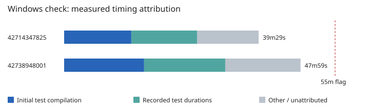

# M3 C3.2 independent review, round 3

**Verdict: block — final acceptance is withheld for the explicitly identified coverage gaps below.** Reviewed product head: `96c630290098e6458279b546e21fa5a2f4af8554`. This is an evidence limitation, not a claim of a demonstrated product defect. No product or specification file was edited. Finding counts: **0 P0 / 0 P1 / 1 P2**. Final test receipts are recorded below.

## Rounds 1–2 closure table

| Finding | Round-3 adjudication |
|---|---|
| C32-R1-01 | Inherited passage/extremum regressions retained unchanged; no new contrary source evidence. |
| C32-R1-02 | Withdrawn under the binding ownership ruling. |
| C32-R1-03 | Exact default retained; SI-104 alias removed in round 2 response. |
| C32-R1-04 | Numeric equality change unchanged; inherited regressions retained. |
| C32-R1-05 | Stored replay union addresses the missing history event; direct interval union unchanged. |
| C32-R1-06 | Finite encoding and scaled norm unchanged; inherited regressions retained. |
| C32-R2-01 | Closed by source inspection and passing inherited/new regressions: `projection_fov` removed; `half_tan` uses reported FOV directly. New dynamic-camera replay oracle plus inherited default/explicit oracles. |
| C32-R2-02 | Closed by source inspection and passing inherited/new regressions: accept coalesces effects before commit; Step stores the union; undo/redo emits it after `doc.changed`. New multi-step/branch-discard/loop/whole-camera-block replay oracles. Acceptance limitations below. |

## New findings

No new demonstrated product defect is asserted. The following verification limitation blocks acceptance rather than allocating SI-105 or silently treating untested requirements as passing:

**C32-R3-01 — P2 — charter A/E acceptance evidence incomplete.** **Required:** independently exercise cancellation of running animation undo/redo, session/UI acceptance and request-owned delivery. **Observed:** existing `c32_contract` cancellation tests exercise evaluation and transform edits, not running undo/redo. New reviewer probes cover scope replay, redo-branch discard, fractional sampling, camera block routing, save, close, open undo refusal and evaluation stability. They do not establish those cancellation/session/UI boundaries. **Reproduction/inspection:** `cargo test --locked -p tt-executor --test c32_contract --test c32_round2 --test c32_r3_history -- --nocapture`, then inspect the enumerated test bodies; these tests pass and lack the required acceptance oracle. **Fix direction:** add focused independent running-history/request/session/UI cancellation assertions; prescribe product changes only if those behavior oracles fail. This is a coverage finding, not a demonstrated product defect or an intentionally failing product test. Counts: **0 P0 / 0 P1 / 1 P2**.

## Register

[evidence/M3-C3.2-r3/register.json](evidence/M3-C3.2-r3/register.json) and [register.md](evidence/M3-C3.2-r3/register.md) enumerate all **36 rows / 383 units**, with **no pending**: 36 implemented registry rows; 293 implemented units and 90 deferred-with-owner. The five divergent rows and two divergent units are re-adjudicated against the inspected fixes and regression evidence. These surface dispositions do not waive the separate acceptance coverage finding. Deferrals and SI-089/096/097/100/101/103 remain binding.

## Declared edits adjudication

The fixed-head reviewer ownership gate `git diff --stat 197bbe2..96c6302 -- 'crates/*/tests/c*_r[0-9]_*' tests/adversarial desktop/src/test reviews/evidence/M3-C3.2-r1 reviews/evidence/M3-C3.2-r2` is empty (`ownership.txt`). Merge `197bbe2` therefore preserves reviewer files unchanged. All 18 inherited C3.1 register files (including the two review-root registers) compare byte-identical at fixed heads in `c31-registers.json`; the earlier fixed-head adjudication remains inherited.

`camera.rs` removes the alias, retaining exact default constants. The builder's two `c32_round1` assertion edits replace the ruled alias premise with explicit-value tangent assertions and retain the exact-default 1e-12 assertion; they do not weaken the ruled behavior. `c32_round2` adds replay assertions. `run.rs::accept/commit` stores and replays the coalesced payload; `history.rs::Step` has no serialization derive. The persistence crate does not serialize executor history. Saving retains live history; opening constructs fresh history. Thus Step::anim introduces no persisted-format field or migration and no digest re-adjudication attributable to history serialization. Existing golden probes still cover the intentional earlier default-FOV change.

ADR-0019 decisions 11/12 match the no-alias and stored replay decisions. SI-104 records the ruling. Full rustfmt checking is restored and the new range-loop exemption removed; `empty_line_after_doc_comments` is unchanged. No inherited reviewer file was edited by this round, including for formatting. The new unwrap in the response diff is the existing cfg(test) commit test updated for its new argument, not an added product unwrap. Allow inventory: **98 lints / 40 files / 0 new**. `TT_COMMIT_REVIEW_RECEIPTS` remains unset. Install precedes Python guards; generated outputs have no tracked delta.

## CI budget attribution

Both complete logs are retained as `ci-42714347825.log` and `ci-42738948001.log`. `ci-binary-timings.json` attributes debug results per test binary, with occurrence suffixes to distinguish equal binary names in different crates. Windows recorded test totals rise **801.28 ? 988.21 seconds**, about **186.93 seconds** of the **510-second** job increase (39m29s ? 47m59s). Workspace test compilation separately rose **13m38s ? 16m14s**, adding **156 seconds** (`ci-workspace-build-times.txt`). Together, initial compilation and recorded test totals explain approximately **343 seconds**; approximately **167 seconds** remain in other job steps/overhead. Per-binary compilation times are unavailable, so new test-binary linking costs cannot be individually attributed. Missing old records mean absent coverage, not zero runtime. Log extraction is finite and does not measure CPU cost.

The round-2 reviewer files total **17.42 seconds** in Windows debug. None exceeds 60 seconds. The largest is `c32_r2_path_budget` at **8.33s**, followed by `c32_r2_c22_golden` at **4.84s**. Their execution time alone cannot explain the 8m30s increase; their compilation contribution is not isolated. Existing `compile_fail` takes **176.04s** (previous 135.87s); `c12_r1_macro` takes **64.74s** (previous 53.83s). Recommend moving `tt-executor --test compile_fail` and `tt-executor --test c12_r1_macro` (both under `crates/executor/tests/`), those two expensive compile/macro oracle binaries, into a dedicated release-oracle job, preserving their actual execution on both OSes and verifying trybuild behavior under that profile; retain lightweight C3.2 regressions in debug. Measure build/step durations before claiming this recovers all headroom. Do not disable or relax their assertions.

## Determinism and performance adjudication

Independent downloads from run 42738948001: all seven E2 PNG files are byte-identical across OSes, as are base and variant E4 evaluate.json (`cross-os.json`). Hashes remain `eae7bcae41a8873efade57c33751ed9cd5878fe0a2a4a8da064a95013bdc9c4f` and `5708fccab82424510fb5c23b96712ad916403a93a27e4d81702d9e2cbd394ebe`. These payloads do not contain passage frames. The new non-horizontal `anim.path.get` probe records its full payload for repeatability (`passage-local.json`, reconstructed from the wrapped native log); cross-OS passage-byte comparison is a mandatory downstream gate, not inferred from E4 equality.

Both OS measurement receipts are retained as `budget-Windows.json` / `budget-macOS.json`: 24 nested nodes, 1000 points/path, 1000 keys/channel. Windows deepest-node 10k/100k frames: 0.541/5.172s; all 24 nodes over 10k frames: 3.704s; path sampling: 4.521s; function sampling: 0.076s; passage readback: 0.0037s. Completed outcomes support the ADR workload-account gate for these cases, not a universal wall-clock guarantee. ADR-0019's 300-million-unit account and 1-million-result cap are work constants, not seconds. Release and inherited oracle evidence is retained in the full downloaded CI logs; local results are recorded in separate receipts.

The final `cargo test --workspace --locked -j 4 --no-fail-fast` completed with native exit **0**: **313 result summaries, 1596 passed / 0 failed / 24 ignored** (`workspace-results.json`, `workspace.txt`, `workspace.exit.txt`). All inherited round-1/2 animation regressions pass unchanged. The new six round-3 tests pass; their targeted debug binary totals are 0.06s (camera) and 0.13s (history), with full-workspace totals 0.24s / 0.31s respectively; none exceeds 60 seconds. Both clippy invocations, full rustfmt and cargo deny have native exit 0. All 51 reviewer Python suites and 333 front-end tests pass; lint, types and build pass. SDK conformance is 24/24 in debug/release on both CI OSes. All 18 inherited C3.1 registers compare byte-identically at fixed heads.

The initial overbroad per-crate test run compiled successfully and was deliberately stopped during redundant inherited geometry tests (native exit 1); it is retained as `per-crate.txt`/`per-crate.exit.txt`, not counted as a successful completed test run. The focused run then passed, followed by the single complete unfiltered workspace invocation above. No cargo invocation remains running. No test-rewritten tracked file remains. The pre-workspace `df -h /c` receipt shows **193 GB available**. No product, inherited test, specification or old evidence file was changed.

## Residual risks

Session/UI cancellation acceptance is not established by executor-global subscriptions. Replayed payload scope tests do not exhaust every mixed batch or unusual hierarchy. Cross-OS recorded E4 values do not prove unrecorded passage-frame bytes. Finite seeded tests do not exhaust ill-conditioned transforms, extrema or enormous documents. Shared runner times do not establish hard latency bounds. D-5 remains migratable and built to spec 05 under SI-096; bones remain M6 C6.3. Bitmap native mapping, effects and render integration retain downstream owners; C22-T2/R1-12 remain M11.

## C3.3 readiness list

1. Close the round-3 acceptance gap with independently exercised running undo/redo cancellation, session/UI acceptance, request-owned progress/error delivery, fresh-open history, and unchanged state/revision after cancellation.
2. Construct deterministic render lists from evaluated transforms, hierarchy, depth/stacking, exposures, visibility, annotations and roles; compare exact lists against independent static/keyed fixtures.
3. Resolve bitmap native-size/DPI mapping; prove one imported pixel maps to one output pixel at the default table plane and bounds/render/hit-test agree, retaining 100 drawing units per field.
4. Compare frame rendering across attached/headless, repeated processes and both OSes, including mirrored/skewed parents, pivots, arbitrary roll, dynamic FOV and near-plane cases.
5. Verify contact-sheet sampling, layout, labels and metadata; compare repeated image/metadata bytes and deliver companions together.
6. Derive frame descriptions from the evaluated render list; check visible/omitted content, roles and annotations against rendered output.
7. Test hit-testing using independent transformed geometry, depth/stacking, visibility, pivots and pixel/field boundary oracles with overlapping mirrored nodes.
8. Verify local/world/camera/screen conversions at fractional frames using forward/inverse oracles, aspect ratios, singular transforms and near-plane refusals.
9. Verify PNG-sequence ranges/names, atomic delivery, request-owned cancellation and deterministic bytes; surface frames and metadata together.
10. Retain query purity, stale guards, undo/save-open, rollback, mixed atomic batches and complete invalidation scope across key/segment/loop/path/camera edits.
11. Carry SI-096 path/function/velocity IPC and named bone/effect/view deferrals explicitly; E1 replay remains C3.4 and M11 owners remain unchanged.
12. Run inherited/release suites, E2 PNG and both E4 OS scenarios, plus a non-horizontal anim.path.get passage-frame cross-OS byte gate. Retain generator/schema/IPC freshness, executable examples, engineering and watchdog gates.

## Closure checklist

- Re-check C32-R3-01 with direct session/UI cancellation and fresh-open history evidence; adjudicate any failure separately from a coverage limitation.
- Run all new c32_r3 probes, both inherited failing-finding regression targets and builder replay tests without modifying inherited assertions.
- Check reviewer rustfmt/clippy, unchanged product/spec/inherited files, register totals/no pending, and exact receipt provenance.
- Confirm any test relocation preserves both-OS execution; retain the measured debug timing table and do not infer whole-job savings from binary runtimes alone.
- Verify final workspace native exit, restore generated/transient files, check status, commit and push the review branch.
