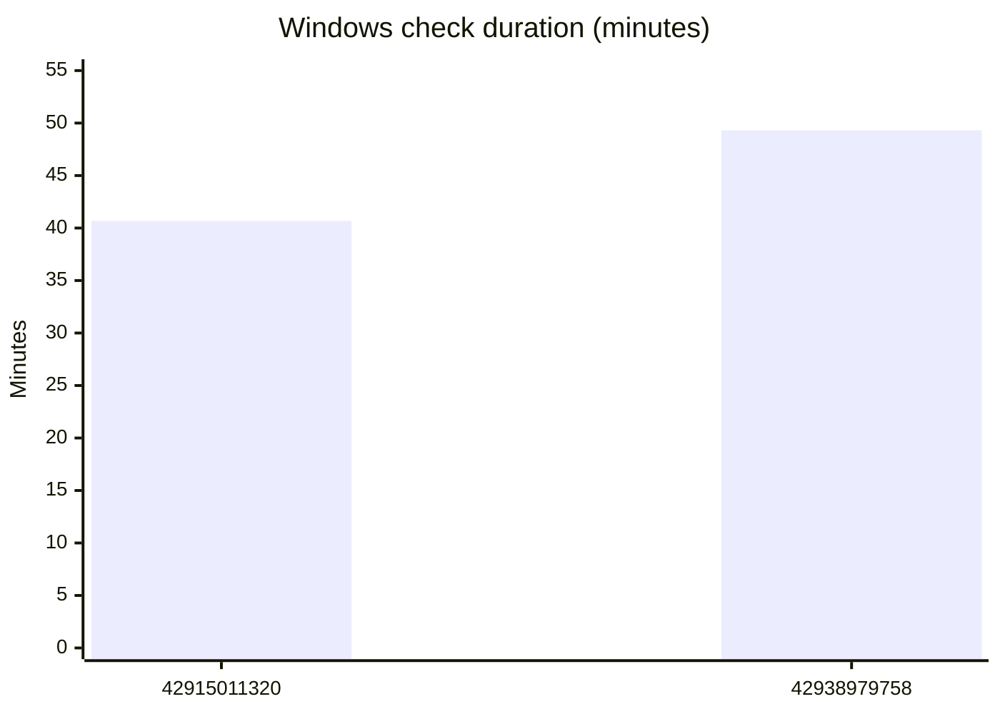

# M3 C3.3 round-four scoped closure review

**Verdict: pass.** At fixed response head `4984c253713553fd686e6876dc8a9b13b236e6da`, C33-R3-01 and the authorized waiting-test sequencing condition are closed. Independent terminal-record, same-session save/open, MCP, committed-cancel/refused-restore and retry probes pass; inherited suites remain unchanged apart from the authorized two-line move. **0 P0 / 0 P1 / 0 P2 open product findings.** The unfiltered workspace receipt retains only the accepted crash-premise exception; it is not described as an entirely green unfiltered run. No product code or specification was edited.

## Closure checklist

### 1. C33-R3-01

| Adjudication | Evidence |
|---|---|
| Closed. The independent range probe waits for frame work, cancels, then checks `cancelled`, exact `job.cancelled` (not `command.timeout`) and recovery warnings through list/wait. Error and warning values survive same-session save/open; a fresh session cannot find that job. MCP checks exact state/code/warning. A cancellation issued from the publication boundary returns running and cannot change the committed outcome: failed, `export.rollbackIncomplete`, unrestored target and warnings survive list/wait/MCP. | `crates/executor/tests/c33_r4_closure.rs`, `c33_r4_rollback.rs`; corresponding MCP roots; [workspace](evidence/M3-C3.3-r4/workspace.log), [MCP rollback](evidence/M3-C3.3-r4/rollback-mcp.log) |

### 2. Sequencing authorization

| Adjudication | Evidence |
|---|---|
| Closed. Exactly the two injection statements moved before starting the job; all assertion statements match both `3fbf777` and the round-three assertion receipt. The stale assertion message remains a wording note. Both restored tests pass locally and in both OS check jobs. Only the accepted C3.3 crash skip remains; earlier milestones' release-routing skips remain. | [audit](evidence/M3-C3.3-r4/audit.json), [CI attribution](evidence/M3-C3.3-r4/ci-attribution.json), workspace |

### 3. Inherited probes and builder suites

| Adjudication | Evidence |
|---|---|
| Pass. Workspace executes every `c33_r1_*`, `c33_r2_*`, `c33_r3_*`, builder `c33_round1/2/3*` and other C3.3 suites, plus inherited `c23_r3_cancellation` and `c33_round1::a_render_list_query_evaluates_each_node_once_per_frame` coverage. Ownership gate shows only `c33_r2_wait.rs`, four changed lines (+2/-2). | [execution summary](evidence/M3-C3.3-r4/execution-summary.json), audit, workspace |

### 4. Refused restore / recovery

| Adjudication | Evidence |
|---|---|
| Pass. Independent probes read byte-identical original bytes from retained backup while restoration is refused, retain sidecar, publish no partial manifest, then restore original target bytes on the next job. Inherited live-child probe holds an actual range job in another process and verifies untouched sidecar/no recovery report. Marker-like unrelated files remain byte-identical and unreported. | `c33_r4_rollback`, unchanged `c33_r3_transaction`, `c33_r3_live`, `c33_r3_recovery`; workspace |

### 5. Register

| Adjudication | Evidence |
|---|---|
| Recovery and range units re-adjudicated implemented; every other adjudication retained. **183 implemented / 0 divergent / 0 missing / 14 deferred with owner / 1 closed / 0 pending**, 198 total. | [JSON](evidence/M3-C3.3-r4/register.json), [Markdown](evidence/M3-C3.3-r4/register.md) |

### 6. Declared edits / gates

| Adjudication | Evidence |
|---|---|
| Pass. Exact patch: jobs +6/-1 (7 changed lines), render +10/-3 (13 changed lines), CI +1/-6 (7 changed lines). ADR-0020 decision 11, handoff sections 3/4 and traceability agree with behavior. No added forbidden product constructs; allow inventory 97 lints / 40 files / 0 new; deny passes; generator emits 495 declarations with no tracked change. Product goldens unchanged since `e61c265`; 48 historical register comparisons pass at their fixed heads. SI list unchanged, SI-111 free. New reviewer roots pass rustfmt and strict clippy. | audit, [historical pins](evidence/M3-C3.3-r4/historical-register-pins.json), `allows.log`, `deny.log`, `generator.log`, final `fmt-*.log` / `clippy-*.log` |

### 7. CI budget

| Adjudication | Evidence |
|---|---|
| Adjudicated below. Both authenticated log downloads retained; all 28 current jobs succeed at the fixed head. Increase is attributed to observed steps and binary durations, without asserting a cause for runner speed differences. | [per-step/per-binary tables](evidence/M3-C3.3-r4/ci-attribution.md), [raw structured attribution](evidence/M3-C3.3-r4/ci-attribution.json), `ci-old.log`, `ci-new.log` |

### 8. Final workspace

| Adjudication | Evidence |
|---|---|
| Native exit 101: 1697 passed / 1 failed / 24 inherited ignored / 0 filtered. Only accepted crash-premise exception. Storage checked immediately before invocation: 159,450,107,904 bytes; `df -h /c` reports 149 GiB, above 120 GB. No deletion to make space. Final tracked-file audit confirms only new round-four files; historical outputs did not require restoration. | `workspace.exit`, `workspace.log`, [storage](evidence/M3-C3.3-r4/workspace-storage.json), `df.log`, `final-status.txt` |

All evidence paths in the table are relative to the repository or [round-four evidence](evidence/M3-C3.3-r4/). The three builder tests were read: both executor tests and the MCP test assert error codes and warnings as well as status; none is status-only. The builder's rollback case asserts one unrestored target; the independent probes add list/MCP, backup-byte and retry checks.

## CI budget attribution

Windows `check` rose **40m41s → 49m19s (+8m38s)**. It remains 5m41s below the requested 55-minute operating ceiling; the checked-in job timeout is actually 60 minutes. There is no Cargo manifest or lockfile change. Full per-step and per-binary comparisons, including all unchanged and short binaries, are in the linked attribution tables.

| Windows check component | Old | New | Increase |
|---|---:|---:|---:|
| Workspace test step | 29m12s | 34m29s | 5m17s |
| Cargo test compilation within that step | 15m13s | 17m51s | 2m38s |
| Remaining test-step wall time | 13m59s | 16m38s | 2m39s |
| Frontend lint/type/test/format/licences | 2m18s | 3m02s | 44s |
| Both frontend builds | 5s | 7s | 2s |
| Clippy step | 1m19s | 1m41s | 22s |
| Diagnostics feature step | 2m52s | 3m48s | 56s |
| MCP conformance/build/measurements step | 2m22s | 3m06s | 44s |

The remaining increase is checkout/setup/fetch and small steps plus step-boundary overhead. Summed top-level binary harness durations rise 822.69s → 980.31s (+157.62s), consistent with the post-build increase. Nested child summaries are retained separately and excluded from that sum. Restoring the two tests increases their binaries by only 0.80s combined; the two new builder binaries total 1.90s. These changes do not explain most of the rise. Broad Windows compilation and execution increases are observed; causation by cache state or runner contention is not established by these two runs. macOS check falls from 33m17s to 29m45s.

| Debug binary above 30s in the new Windows run | Seconds | Recommendation before C3.4 |
|---|---:|---|
| executor `c33_r2_depth` (reviewer round 2) | 53.75 | Move `seeded_anchor_groups_4096` to `c33 render release` on both OSes; route that exact name out of debug check. |
| executor `c33_r2_stress` (reviewer round 2) | 32.08 | Move `deep_and_broad_scene` to the same release job; keep `last_target_readonly_preserves_originals` in debug check and run the complete binary in release. |
| executor `c31_r3_hierarchy` | 51.88 | Move `random_hierarchy_edits_4096_keep_independent_parent_and_level_model` into `review properties release` on both OSes, with its exact-name debug skip. |
| executor `c32_r4_closure` | 47.35 | Retain debug cancellation/deadline coverage; split expensive setup/replay corpus from the timing-sensitive smoke path before moving the corpus to a release job. |
| vector `c21_r2_geometry` | 43.09 | Split the dense fitting/100k-sample corpus into release headless geometry coverage; retain watchdog cases in debug. |
| executor `c32_round3` | 42.19 | Retain debug cancellation/deadline cases; share the preceding C3.2 corpus split rather than suppressing the whole binary. |
| headless `cancel_phases` | 38.22 | Retain debug cancellation phases; wall-clock observation does not show release relocation will shorten waits. |
| executor `c22_r3_cache` | 31.00 | Keep cache/cancellation assertions in debug; profile its case breakdown before selecting corpus-only relocation. |
| executor `c12_kernel_state` | 30.46 | Retain lock/deadline smoke coverage; no blanket release skip recommended. |

No round-one or round-three C3.3 reviewer binary exceeds 30s in the current debug CI run; round-two depth/stress are explicitly included above. The proposed first three moves remove roughly 138s of current debug binary time (less the retained readonly case), plus their debug compilation/linking cost. This is a routing recommendation, not a measured release speedup. The existing C3.3 release job has a 30-minute budget and currently takes 10m19s on Windows; retain both-OS execution and receipts rather than dropping tests or raising check's budget.

Proposed release invocations: `cargo test --release --locked -p tt-executor --test c33_r2_depth --test c33_r2_stress` in `c33 render release`, and `cargo test --release --locked -p tt-executor --test c31_r3_hierarchy` in `review properties release`. Add only the three named corpus functions to debug check's release-routing skip list; retain the readonly and timing-sensitive cases there.

| Job | Old Windows | New Windows | Old macOS | New macOS |
|---|---:|---:|---:|---:|
| c33 render release | 10m58s | 10m19s | 10m08s | 9m41s |
| review properties release | 38m17s | 31m09s | 27m26s | 25m13s |
| history oracles release | 20m25s | 20m31s | 14m05s | 14m51s |

## Residual risks

- Scoped closure retains the prior finite-interleaving limits: PID reuse/unknown liveness can defer recovery; platform-specific liveness error classification is not exhaustively covered. A passing actual live-child probe does not establish every cross-process race.
- Refused restore is induced at filesystem boundaries. Disk exhaustion, every ACL/device failure, concurrent recovery and sidecar persistence failure are not exhaustively simulated. Retained backup bytes are checked before retry; the refused target itself is a directory until the obstruction is removed.
- Encoding/flush calls have no certified interruption-latency bound. Work budgets and finite deep/broad measurements do not establish a universal wall-clock limit.
- Jobs remain session data. Same-session save/open preserves the table; it does not serialize jobs into the project. Fresh-session absence is independently checked.
- The old waiting assertion's text still says staging was injected after the entry sweep; its actual authorized setup now injects before entry recovery. This is stale wording, not a product defect or weakened assertion.
- Initial standalone MCP rollback/check invocations omitted the existing dependency test-hooks feature and failed to compile. Initial strict clippy also identified collapsible conditions in new reviewer code. Those harness diagnostics are retained with `-initial` suffixes; final feature-enabled checks and final-source workspace execution govern closure. No product workaround was introduced.
- The accepted killed-process no-staging premise remains excluded from CI. The unfiltered local run deliberately retains its result; recovery is certified through sidecar-owned next-job probes instead. Attached rendering remains M4 C4.2, thumbnails M5 C5.2; the other fourteen owned deferrals stand.

## C3.4 readiness list

1. Run a headless E1 script pinned to SDK `mcp==2.0.0`: create a fresh 1920?1080, 24 fps project, Ball drawing, painted circle and peg through registered commands; validate and read back the document. MP4 is excluded.
2. Animate frames 1, 12 and 24 with explicit easing; independently verify evaluated positions, rendered centres, extrema and endpoint holds.
3. Render 24 PNGs twice in independent processes; compare bytes, SHA-256 and fixed metadata. Retain a parent-transform/roll/FOV variant respecting the default FOV rule.
4. Render a labelled contact sheet; compare each cell against its single-frame pixels and verify dimensions, columns, sampling, labels and metadata on both OSes.
5. Export all 24 PNGs with the companion manifest in one shallow delivery folder; verify order, names, count, dimensions, hashes, range, fps and duration.
6. Exercise steps/patterns, overwrite/rename/fail, late invalid/read-only targets, limits, cancellation and sidecar-owned recovery. Failed delivery preserves originals byte-for-byte, reports rollback failures, retains retry data and publishes no partial manifest.
7. Verify cancelled/failed warnings and typed errors through list/wait/MCP, same-session save/open and a fresh session. **Closed this round:** R3-01 and the waiting-test conflict. Repeat the listed observations for the C3.4 delivery.
8. Verify describe/hit-test/coordinate agreement at integer frames against analytic geometry and rendered centres, covering hidden ancestors, annotations, background extension and override precedence without history mutation.
9. Retain evaluation counts for list/render/describe/hit-test and N-frame sheets; measure deep/broad scenes against declared work budgets with typed over-budget refusal.
10. Exercise undo/redo/save/reopen and conservative `anim.changed` coverage; compare canonical documents and deterministic renders while identifying volatile timing/job fields.
11. Run release headless E1 on both OSes, inherited release oracles, generator/schema/example/IPC freshness, dependency and lint/ownership checks; retain fixed-head receipts and unchanged golden hashes.
12. At M4 C4.2, compare attached-session and headless PNG/metadata on identical fixture/revision/frames on both OSes. Keep thumbnails at M5 C5.2 and other named deferrals explicit.

